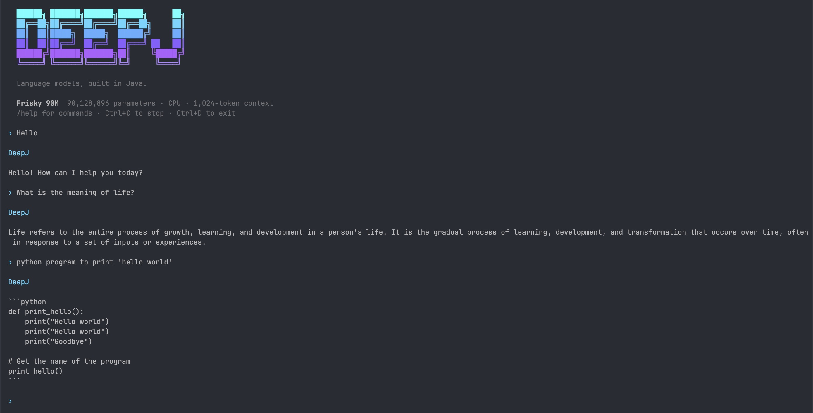
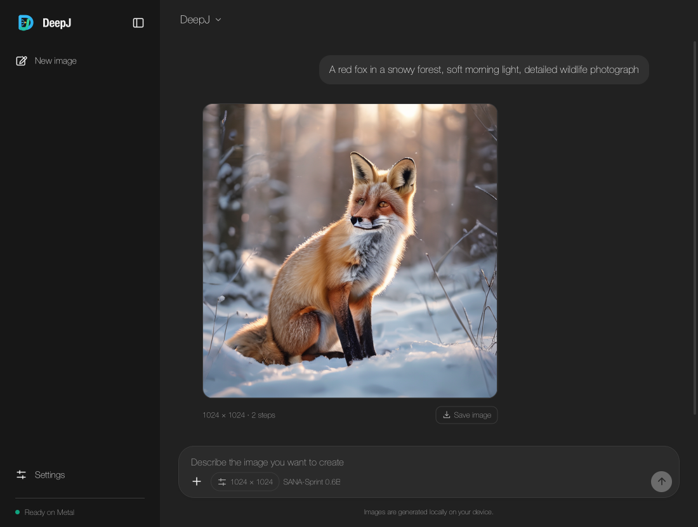
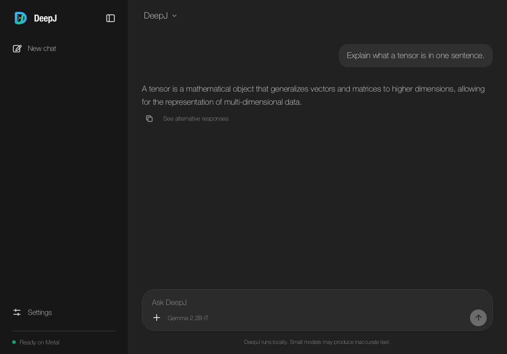

<p align="center">
  
</p>

# DeepJ

<p align="center">
  <a href="https://central.sonatype.com/artifact/io.github.kirstenali/deepj"></a>
  <a href="https://adoptium.net/"></a>
  <a href="LICENSE"></a>
</p>

DeepJ is a Java library for building, training, and running neural networks. It provides N-dimensional tensors, automatic differentiation, composable layers, and CPU execution with optional Apple Metal acceleration.

Build feed-forward networks, convolutional networks, recurrent networks, autoencoders, and Transformers on the same tensor and autograd foundation.

The optional [ONNX module](onnx/README.md) imports supported ONNX graphs for inference and training on CPU or Apple Metal.

[Website](https://kirstenali.github.io/DeepJ/) · [Documentation](docs/README.md) · [API reference](https://kirstenali.github.io/DeepJ/api/)

## Supported networks

| Model type | Implementations |
|---|---|
| Feed-forward networks | `FNN`, with configurable hidden and output activations |
| Convolutional networks | `Conv1D`, `Conv2D`, max/average pooling, and global average pooling |
| Recurrent networks | `RNN`, `GRU`, `LSTM`, individual cells, explicit state, and per-sample sequence lengths |
| Autoencoders | Composable `Autoencoder` with separate encoder and decoder access |
| Transformer encoders | Bidirectional attention, padding masks, and masked mean pooling |
| Decoder Transformers | DeepJ Origin, Orbit, Prism, Nova, Loop, Qwen3, and Gemma 2 for causal language modeling |
| Diffusion models | SANA-Sprint 0.6B for text-to-image and [SANA-Video 2B](docs/sana-video.md) for text-to-video generation |

## Serious inference speed, in Java

Qwen3-1.7B runs through DeepJ's own tensor backend. In short **FP32 tests on an Apple M4**, CPU cached decoding was faster than PyTorch, CPU prompt processing was within 3%, and Metal was faster in both prompt processing and cached decoding than PyTorch MPS.

| Measurement | DeepJ | PyTorch |
|---|---:|---:|
| CPU cached decoding | **12.72 tokens/s** | 9.02 tokens/s |
| CPU prompt processing | 292.8 ms | **286.5 ms** |
| Metal / MPS cached decoding | **12.69 tokens/s** | 12.05 tokens/s |
| Metal / MPS prompt processing | **119.7 ms** | 132.3 ms |

Both engines used FP32 weights, batch size one, a KV cache, a 64-token prompt and the same 16 fixed continuation tokens, with full logit readback and no sampling.

[Measurements, setup and validation](docs/benchmarks/full-qwen-2026-11-07/REPORT.md) · [Individual trials](docs/benchmarks/full-qwen-2026-11-07/results.json)

## Install

DeepJ requires JDK 20 or newer.

Add DeepJ to your project:

```xml
<dependency>
    <groupId>io.github.kirstenali</groupId>
    <artifactId>deepj</artifactId>
    <version>0.13.0-alpha</version>
</dependency>
```

## Try Frisky 90M

[Frisky 90M](https://huggingface.co/netsrik/frisky-90m) is a 90-million-parameter language model trained from scratch with DeepJ. Download it and chat locally with the DeepJ CLI.

Download [`model.dj`](https://huggingface.co/netsrik/frisky-90m/resolve/main/model.dj?download=true) and [`tokenizer.bpe`](https://huggingface.co/netsrik/frisky-90m/resolve/main/tokenizer.bpe?download=true) into a folder named `frisky-90m`. Place the [CLI JAR](https://github.com/KirstenAli/DeepJ/releases/download/v0.13.0-alpha/deepj-cli.jar) alongside that folder, then run:

```bash
java --enable-native-access=ALL-UNNAMED -jar deepj-cli.jar chat ./frisky-90m
```

The CLI streams responses, supports selectable themes, and uses Metal when available with CPU fallback. See the [CLI guide](docs/cli.md) for commands and controls, and the [model card](https://huggingface.co/netsrik/frisky-90m) for training details.



## Try Qwen3-1.7B

[Qwen3-1.7B](https://huggingface.co/Qwen/Qwen3-1.7B) is a pretrained 1.7-billion-parameter language model you can run locally with DeepJ on CPU or Apple Metal. Chat through the CLI or load it in the desktop app.

Download `config.json`, `tokenizer.json`, `model.safetensors.index.json`, and both `.safetensors` shards from the [official model files](https://huggingface.co/Qwen/Qwen3-1.7B/tree/main) into a folder named `qwen3-1.7b`. Build the CLI from the current source and start chatting on Apple Silicon.

```bash
mvn package -Pcli
java -Xmx12g --enable-native-access=ALL-UNNAMED -jar target/deepj-cli.jar \
  --backend metal chat ./qwen3-1.7b --dtype float32
```

For desktop chat, select `config.json` from the same folder in the model picker. See the [Qwen3 guide](docs/qwen3.md) for model details, pretrained loading, and training support.

The desktop **Thinking** switch lets Qwen3 reason before answering. Qwen3 also supports **Agent mode** in DeepJ’s desktop and CLI agent launchers. [Try Agent mode](docs/agent-launchers.md).

## Create images with SANA-Sprint

[SANA-Sprint 0.6B](https://huggingface.co/Efficient-Large-Model/Sana_Sprint_0.6B_1024px_diffusers) brings local text-to-image generation to DeepJ. Describe an image in the desktop app, choose its size and sampling settings, then save the full-resolution result as a PNG.

Download the checkpoint using the [SANA-Sprint guide](docs/sana-sprint.md), start the desktop app, and choose **Open image model folder…** from the model menu.

```bash
JAVA_TOOL_OPTIONS="-Xmx8g" mvn javafx:run
```

The pipeline runs through DeepJ tensors on CPU or Apple Metal. A standalone image launcher is also available in the guide.



## Create videos with SANA-Video

[SANA-Video 2B](docs/sana-video.md) brings local text-to-video generation to DeepJ on CPU or Apple Metal. Describe a scene and its movement, generate a clip through the CLI or desktop app, then play it and save an MP4.

Download the checkpoint using the [SANA-Video guide](docs/sana-video.md). In the desktop app, choose **Open video model folder…** from the model menu. To generate a nine-frame preview with the CLI on Apple Silicon:

```bash
mvn package -Pcli
java -Xmx2560m --enable-native-access=ALL-UNNAMED -jar target/deepj-cli.jar \
  video --model checkpoints/sana-video --backend metal --output fox.mp4 \
  'A red fox slowly walking through a snowy pine forest, gentle falling snow, steady camera'
```

[](docs/sana-video-fox.mp4)

[Watch the generated fox clip](docs/sana-video-fox.mp4) · [Checkpoint setup and generation settings](docs/sana-video.md)

## Try Gemma 2 2B-IT

[Gemma 2 2B-IT](https://huggingface.co/google/gemma-2-2b-it) is available for local chat in DeepJ's CLI and desktop app. It supports streamed replies and optional conversation history, using the same Gemma backbone that encodes prompts for SANA.

Download the model and tokenizer files using the [Gemma 2 guide](docs/gemma2.md), build the CLI from the current source, then run:

```bash
mvn package -Pcli
java -Xmx8g --enable-native-access=ALL-UNNAMED -jar target/deepj-cli.jar \
  --backend metal chat checkpoints/gemma-2-2b-it --max-tokens 256
```

For desktop chat, select `config.json` in the model picker. Already have SANA-Sprint? Its `text_encoder` folder can also be loaded for Gemma chat.



## Documentation

Start with the [documentation index](docs/README.md), or go directly to:

| Guide | Covers |
|---|---|
| [Tensors and precision](docs/tensors.md) | Shapes, views, broadcasting, dtypes, and storage |
| [Automatic differentiation](docs/autograd.md) | Gradients, mutation checks, graph lifetime, and custom operations |
| [Networks and layers](docs/neural-networks.md) | Composition, CNNs, recurrence, autoencoders, and encoder Transformers |
| [Training a model](docs/training.md) | Training APIs by model type, batching, losses, optimizers, and evaluation mode |
| [Distributed training](distributed/README.md) | Train across multiple machines with CPU or Metal workers |
| [ONNX support](onnx/README.md) | Importing graphs, supported operators, CPU/Metal execution, and trainable weights |
| [Saving and loading](docs/persistence.md) | Network weights, persistent buffers, and model checkpoints |
| [CPU and Metal](docs/backends.md) | Backend selection, GPU execution, and temporary tensor ownership |
| <a id="desktop-chat"></a>[Language models](docs/language-models.md) | Decoder architectures, tokenization, text generation, chat, and model bundles |

## Build and release

Build and check the current source with JDK 20 or newer:

```bash
mvn clean verify
```

On supported Apple Silicon macOS with a working Metal device and desktop session, run `mvn clean verify -Pfull-coverage` for the hardware-dependent checks. See [coding standards and regression testing](docs/quality-and-regression.md) for the validation requirements.

Maintainers can create signed source, Javadoc, and binary artifacts and publish them through the Central Portal with:

```bash
mvn clean deploy -Pcentral-release
```

Maven Central releases are immutable; update the project version before publishing another release.

## License

DeepJ is available under the [MIT License](LICENSE).
