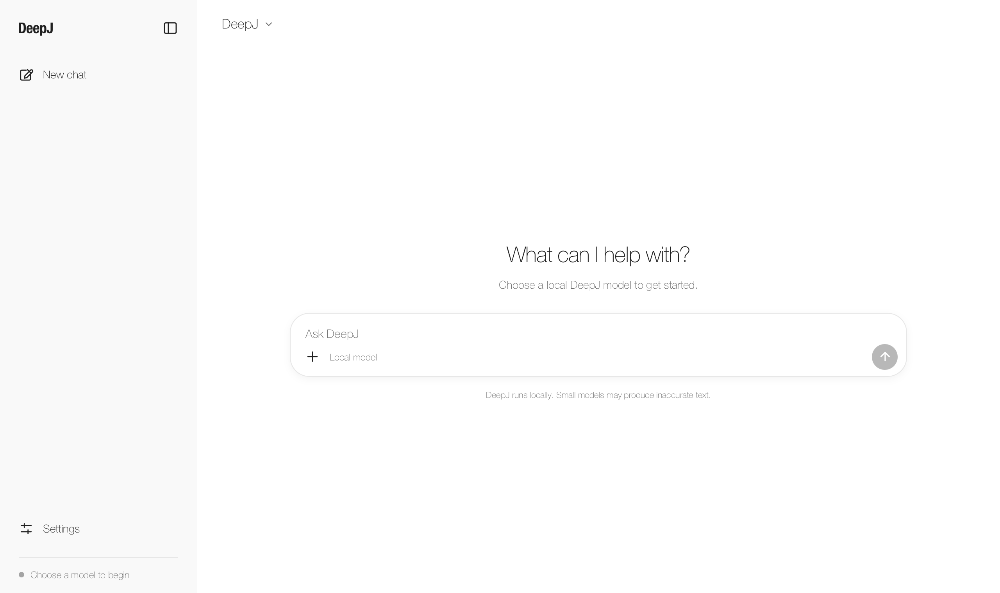

<p align="center">
  
</p>

# DeepJ

<p align="center">
  <a href="https://central.sonatype.com/artifact/io.github.kirstenali/deepj"></a>
  <a href="https://adoptium.net/"></a>
  <a href="LICENSE"></a>
</p>

DeepJ is a small Java library for learning, testing, and experimenting with tensors and decoder-only Transformers. It includes automatic differentiation (autograd), four trainable model families, BPE tokenization, model persistence, training utilities, and optional Apple Metal acceleration.

DeepJ is an alpha project. Its compact model families are designed to make different Transformer architectures easier to inspect and understand.

## Install

DeepJ requires JDK 20 or newer.

Autograd is available from source; the Maven release below predates it.

```xml
<dependency>
    <groupId>io.github.kirstenali</groupId>
    <artifactId>deepj</artifactId>
    <version>0.10.0-alpha</version>
</dependency>
```

API documentation is available in the [Javadoc](https://kirstenali.github.io/DeepJ/api/).

## What is included

- A two-dimensional `Tensor` API with first-order [autograd](docs/autograd.md) on CPU and Metal.
- CPU execution and an optional Metal backend with fused Apple GPU training operations.
- DeepJ Origin with learned positions, LayerNorm, and GELU.
- DeepJ Orbit with RoPE, RMSNorm, and SwiGLU.
- DeepJ Prism with low-rank Q/KV attention, RoPE, RMSNorm, and SwiGLU.
- DeepJ Nova with grouped-query attention, optional QK normalization, and shared input/output embeddings.
- DeepJ Loop with a shared recurrent core, context reinjection, and full autograd through every pass.
- Byte and BPE tokenizers, including BPE training and persistence.
- Causal language-model training, AdamW, gradient clipping, and complete resumable checkpoints.
- Bounded-memory sequential, random-access, and response-only datasets.
- Versioned model bundles for sharing DeepJ checkpoints on Hugging Face.
- A small optional JavaFX chat UI.

## Desktop chat



The optional desktop UI loads a local DeepJ checkpoint and streams generated text as it arrives. It includes selectable themes and keeps generation settings tucked away.
It automatically uses Metal on supported Apple GPUs and falls back to the CPU elsewhere.

Under Settings → Generation settings:

| Setting | What it changes |
|---|---|
| Temperature | Lower values favor likely next tokens; higher values give other choices a better chance. |
| Top-k | Samples from the top `k` token choices; `0` considers all. |
| Max tokens | Limits how many new tokens are generated; they are not words. |
| Seed | Controls sampling randomness; changing it can change the response. |
| Repetition penalty | Makes the model less likely to repeat itself. `1.0` turns it off; try `1.1` if responses loop. |

Run it from this repository with JDK 20 or newer:

```bash
JAVA_HOME=$(/usr/libexec/java_home -v 20) \
  mvn org.openjfx:javafx-maven-plugin:0.0.8:run
```

Choose a `.dj` model file in the app. The screenshot shows the initial screen before a model is loaded.

## Quick start

Download a DeepJ model bundle containing `model.dj` and `tokenizer.bpe`, then load it from one directory:

```java
import io.github.kirstenali.deepj.models.DeepJChat;

import java.nio.file.Path;

DeepJChat chat = DeepJChat.load(Path.of("downloaded-model"));
String answer = chat.generate("What is a computer?");
```

The loader reads the tokenizer and checkpoint settings, applies the saved prompt format,
and returns only the generated answer. `chat.stream(prompt, listener)` delivers partial
answers as they are generated. Each call is independent; conversation history is not
retained. `ModelLoader` and `TextGenerator` APIs remain available for advanced use.

## Models

| Model | Main components |
|---|---|
| `DeepJOrigin` | Learned positions, causal multi-head attention, LayerNorm, GELU MLP |
| `DeepJOrbit` | RoPE attention, RMSNorm, SwiGLU MLP |
| `DeepJPrism` | Low-rank Q/KV attention, RoPE, RMSNorm, SwiGLU MLP |
| `DeepJNova` | Grouped-query attention, optional QK normalization, tied embeddings, bias-free SwiGLU MLP |
| `DeepJLoop` | Repeated shared core, context reinjection, loop-aware residual scaling, Nova attention and MLP |

All five models share DeepJ's causal language-model API. They currently recalculate the full context for every generated token because attention caching is not yet implemented.

The [looped 100M training example](docs/looped-training.md) reuses the Frisky datasets and tokenizer.

## Frisky 90M

Meet [Frisky 90M](https://huggingface.co/netsrik/frisky-90m), a 90-million-parameter DeepJ Prism model trained from scratch through pretraining, mid-training, and instruction fine-tuning.

Download its `model.dj` and `tokenizer.bpe` files to try the quick start above or chat with it in the desktop UI. Frisky is experimental and can repeat itself or make factual mistakes; its model card has details and limitations. The [training examples](src/main/java/io/github/kirstenali/deepj/examples) remain available for exploration; their prepared datasets are not included in the repository.

## Current limitations

- The public API and checkpoint format may change before a stable release.
- Tensors are currently two-dimensional and use `float32` values.
- Metal support is limited to Apple Silicon macOS; other platforms use CPU execution.
- Text generation recalculates the full context for every new token because attention caching is not yet implemented.
- Hugging Face bundles require DeepJ and cannot be loaded directly by Python Transformers.
- The library has not been validated for safety-critical or production inference workloads.

## Build and release

Build the library locally:

```bash
JAVA_HOME=$(/usr/libexec/java_home -v 20) mvn clean verify
```

Maintainers can create signed source, Javadoc, and binary artifacts and publish them through the Central Portal with:

```bash
JAVA_HOME=$(/usr/libexec/java_home -v 20) \
  mvn clean deploy -Pcentral-release
```

Maven Central releases are immutable; update the project version before publishing another release.

## License

DeepJ is available under the [MIT License](LICENSE).
