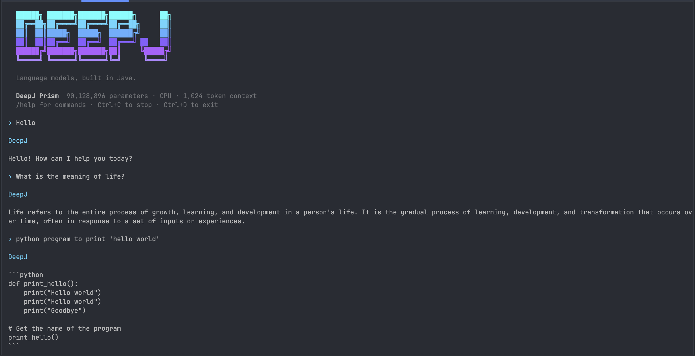

# DeepJ command line



The optional CLI provides streaming terminal chat, single-prompt generation, checkpoint inspection and backend diagnostics. It uses the same models, saved prompt formats and generation API as the Java library. No server or network connection is needed to use downloaded models.

## Build and start

Build the CLI from the current source checkout with JDK 20 or newer:

```bash
mvn package -Pcli
java --enable-native-access=ALL-UNNAMED -jar target/deepj-cli.jar chat ./frisky-90m
```

The model directory should contain `model.dj` and, for BPE models, `tokenizer.bpe`. You can also pass a `.dj` checkpoint path with its tokenizer alongside it. Architecture and prompt formatting are read from the checkpoint; enter your question normally, preserving your preferred capitalization.

The CLI selects Metal when available and otherwise uses the CPU. Use `--backend cpu` or `--backend metal` to select explicitly. Explicit Metal selection reports an error if unavailable rather than silently falling back.

For CPU-only chat:

```bash
java --enable-native-access=ALL-UNNAMED -jar target/deepj-cli.jar chat ./frisky-90m --backend cpu
```

For Frisky, type only your question; the saved `Instruction:\n...\nResponse:\n` template is applied
automatically, just as in the desktop UI. Do not add those markers yourself.
The screenshot illustrates the interface, not a guarantee of response accuracy.

## Commands

| Command | Purpose |
|---|---|
| `chat MODEL` | Open streaming terminal chat. |
| `generate MODEL --prompt "Hello"` | Stream one answer to standard output. |
| `inspect MODEL` | Read embedded settings, parameter count and file size without loading weights. |
| `doctor` | Report Java and CPU/Metal availability without loading a model. |

Use `--help` after any command for its options. Generation options match the [desktop settings](language-models.md#desktop-chat): `--max-tokens`, `--temperature`, `--top-k`, `--seed` and `--repetition-penalty`.

For Orbit, Prism, Nova and Loop, `--rolling-cache` keeps incremental decoding after the context
window fills. It is opt-in: responses may change after the first token is evicted. See
[rolling generation](inference.md#rolling-generation) for the behaviour and limitations. In chat,
use `/set context-window rolling` or `/set context-window rebuild` to select the next request's mode.

## Terminal controls

Enter sends a prompt; Alt+Enter inserts a line. Up-arrow recalls session prompts and Tab completes slash commands. `/help` lists the available chat commands; `/settings` shows sampling values and `/set seed 42` changes a setting for the next response. Ctrl+C stops generation or cancels the current input; Ctrl+D or `/exit` closes the model and exits.

Choose `--theme aurora`, `--theme ember` or `--theme mono`, or change it in chat with `/theme`. The display adapts to narrow terminals. `--no-banner` hides the wordmark, and `--color never` disables styling. Automatic color respects `NO_COLOR`.

Prompts are independent: terminal input history is not sent as conversation context and is not saved to a history file. The model's configured prompt format is applied automatically. Generation uses a fresh KV-cache session for each request.

## Scripts and files

`generate` prints only generated text to stdout and reports errors on stderr. It accepts a literal prompt, a UTF-8 file or piped input:

```bash
java --enable-native-access=ALL-UNNAMED -jar target/deepj-cli.jar generate ./frisky-90m --prompt "What is Java?"
java --enable-native-access=ALL-UNNAMED -jar target/deepj-cli.jar generate ./frisky-90m --prompt-file prompt.txt
printf 'What is Java?' | java --enable-native-access=ALL-UNNAMED -jar target/deepj-cli.jar generate ./frisky-90m
```

File and stdin prompts are limited to 1 MiB. Terminal-control characters are removed from generated text. Successful commands return status `0`, invalid arguments return `2`, and loading or runtime failures return `1`. Inspection and inference do not modify checkpoints or resume training.
