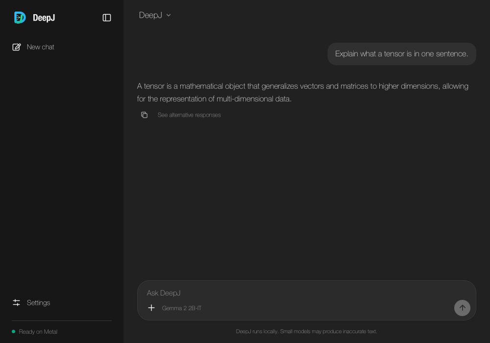

# Gemma 2 chat

DeepJ runs Gemma 2 2B-IT locally in Java through its tensor backend. The CLI and desktop application support streamed replies, conversation history, and cached token generation on CPU or Apple Metal.

The chat model and SANA's prompt encoder use the same Gemma 2 backbone. Gemma's tokenizer, normalization, alternating local/full attention, rotary positions, and score softcaps are implemented with DeepJ operations.

## Get the weights

Download [Google's Gemma 2 2B-IT checkpoint](https://huggingface.co/google/gemma-2-2b-it), including its configuration, tokenizer files, safetensors index, and both weight shards. Hugging Face access to Google's repository requires accepting the model's terms.

```sh
hf download google/gemma-2-2b-it --local-dir checkpoints/gemma-2-2b-it
```

If you already downloaded the complete SANA-Sprint checkpoint, you can use its `text_encoder` folder directly. DeepJ finds the tokenizer in the neighbouring `tokenizer` folder. This reuses the existing Gemma 2 2B-IT weights without another download.

## CLI

Build the current source, then open a chat:

```sh
mvn package -Pcli
java -Xmx3g --enable-native-access=ALL-UNNAMED -jar target/deepj-cli.jar \
  --backend metal chat checkpoints/gemma-2-2b-it --max-tokens 256
```

For BF16 CPU execution, use `--backend cpu` with `-Xmx8g`, since weights occupy JVM memory. Chat loads BF16 weights by default; `--dtype float32` requests FP32 storage. The model has approximately 2.6 billion parameters: weights alone occupy roughly 5.2 GB in BF16 or 10.4 GB in FP32, before caches and other working memory. BF16 is the default for the 16 GB Apple Silicon setup used for validation.

The existing `/set history on`, `/set history off`, `/clear`, sampling settings, Stop, and exit controls work with Gemma. History is off by default. For a single response, use `generate` with `--prompt` instead of `chat`; `inspect` reads the checkpoint's configuration and weight inventory without loading the parameters.

## Desktop

```sh
JAVA_TOOL_OPTIONS="-Xmx3g" mvn javafx:run
```

Choose **Open local model…** and select `config.json` from the Gemma checkpoint folder. For an existing SANA download, select `text_encoder/config.json`; select SANA's `model_index.json` when you want image generation instead.

Gemma uses the existing chat composer, response streaming, themes, and optional conversation-history control. Its standard KV cache is automatic. The separate rolling-cache option is hidden for Gemma.

Set `-Ddeepj.chat.gemma2.dtype=float32` through `JAVA_TOOL_OPTIONS` to request FP32 desktop weights when sufficient memory is available. Explicit
`float16` and `bfloat16` values keep embedding activations and projections compact
and use the shared CPU/Metal matmul paths; normalization and softmax retain their
upstream wider calculations.



## Model API and validation

`Gemma2` implements `CausalLM`. Its differentiable `forward(...)` and `parameters()` use DeepJ autograd. `Gemma2Backbone.forward(...)` exposes prompt features for image conditioning. Generation sessions disable graph recording and own their KV caches; close each session when finished. `Gemma2ChatModel` provides the shared CLI/UI conversation formatting and streaming adapter.

The tokenizer adds one leading BOS token. Chat formatting uses Gemma's `user` and `model` turn markers and stops at EOS or end-of-turn. Recent whole conversation turns are fitted into the model's context before generation.

Small independent Transformers fixtures verify full logits, FP32/BF16 cached decoding across local attention boundaries, cache growth, tied-head embedding gradients, token IDs, UTF-8 streaming, and chat formatting. Existing CLI and JavaFX bridge tests exercise checkpoint routing and reply rendering. The full Gemma 2 2B-IT weights supplied with the official SANA checkpoint were also tested through the desktop and CLI on Apple M4 Metal.

```sh
mvn -Dtest='Gemma2*Test' test
mvn -Dtest=Gemma2ReferenceTest -Dgemma.test.metal=true test
```

The architecture follows the [Transformers Gemma 2 implementation](https://github.com/huggingface/transformers/blob/v4.51.3/src/transformers/models/gemma2/modeling_gemma2.py). Model weights retain their upstream licence and terms.

[Apple M4 demo measurements](benchmarks/media-demo-2026-11-07/REPORT.md) record full-checkpoint FP16/BF16 decoding, prompt processing, streaming replies and numerical checks against PyTorch MPS.
