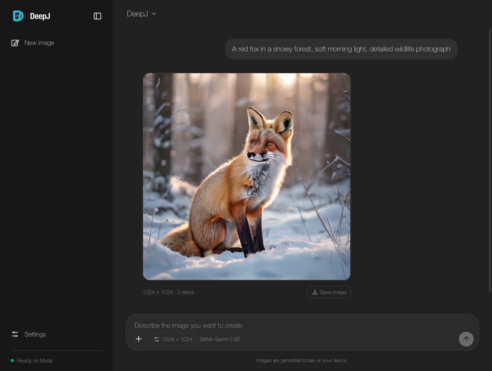

# SANA-Sprint text-to-image

DeepJ implements SANA-Sprint 0.6B with its Gemma 2 text encoder, conditioned image transformer, stochastic consistency sampler, and DC-AE image decoder. Inference runs locally in Java through DeepJ tensors on CPU or Apple Metal. Python is used only to regenerate independent test fixtures.

The implementation lives in `io.github.kirstenali.deepj.nn.diffusion.sana`. Images can be generated through a standalone launcher or the existing desktop application.

## Checkpoint

Use the complete [official SANA-Sprint 0.6B checkpoint](https://huggingface.co/Efficient-Large-Model/Sana_Sprint_0.6B_1024px_diffusers), revision `aa76e7f4f4928f378716b6716a2130fba3caf5b1`:

```sh
hf download Efficient-Large-Model/Sana_Sprint_0.6B_1024px_diffusers \
  --revision aa76e7f4f4928f378716b6716a2130fba3caf5b1 \
  --local-dir checkpoints/sana-sprint
```

Keep the `tokenizer`, `text_encoder`, `transformer`, and `vae` folders with their JSON configuration and safetensors files. The image transformer has about 600 million parameters; the full pipeline also needs the larger Gemma 2 encoder and DC-AE decoder. The files occupy approximately 7.7 GB (7.2 GiB). Model weights are downloaded separately and are not bundled with DeepJ.

## Generate an image

Build the existing CLI distribution, then invoke the new image entry point:

```sh
mvn -Pcli -DskipTests package
java -Xmx3g --enable-native-access=ALL-UNNAMED \
  -cp target/deepj-cli.jar io.github.kirstenali.deepj.nn.diffusion.sana.SanaImageCli \
  --model checkpoints/sana-sprint --backend metal --output sana.png \
  'A red fox in a snowy forest, soft morning light, detailed wildlife photograph'
```

Use `--backend cpu` for CPU execution. The defaults are 1024 × 1024 pixels, two sampling steps, guidance 4.5, and seed 42. `--width`, `--height`, `--steps`, `--guidance`, `--seed`, and `--dtype` are configurable. Dimensions must be multiples of 32 between 32 and 2048; sampling supports one through four steps. The checkpoint is designed for 1024-pixel images. Memory needs increase with resolution.

The pipeline loads and releases each model stage in sequence. Gemma uses BF16 weights and activations. The image denoiser defaults to FP32; select
`--dtype float16` or `--dtype bfloat16` for compact denoiser and DC-AE decoder weights and activations.
The sampler keeps FP32 state, as in the Python pipeline; the DC-AE decoder follows the selected precision.
RMS statistics use FP32, with normalized values, scale and bias rounded in the weight dtype as in Diffusers. The
published [0.6B Python example](https://huggingface.co/Efficient-Large-Model/Sana_Sprint_0.6B_1024px_diffusers)
uses BF16 model weights, including DC-AE. During generation, DeepJ disables autograd graph recording. Image arithmetic stays on the selected tensor backend; small prompt features and final latents pass through host memory between model stages. Output is an RGB PNG.

A fixed seed repeats DeepJ's Gaussian noise sequence. Java and PyTorch use different random-number generators, so matching seed values do not produce identical noise across the two implementations.

## Desktop UI

Download the [desktop JAR](https://github.com/KirstenAli/DeepJ/releases/download/v1.0.0/deepj-desktop.jar)
and launch it with JDK 20 or newer:

```sh
java -Xmx3g --enable-native-access=ALL-UNNAMED -jar deepj-desktop.jar
```

For CPU execution, use `-Xmx8g` and append `--backend cpu` after the JAR
name. See [CPU launch options](desktop.md#cpu-or-metal).

Choose **Open local model…** from the model menu in the upper left and select
`checkpoints/sana-sprint/model_index.json`. DeepJ reads the text encoder,
Transformer and decoder configuration files automatically. See the
[desktop guide](desktop.md#cpu-or-metal) for source builds and other platforms.

The composer switches to image descriptions. Its image-size button opens the existing Settings dialog, where you can choose size, sampling steps, seed, prompt guidance, and precision. The precision control selects the denoiser and image-decoder dtype. The window shows generation stages and keeps the Stop action available. After stopping, it waits for the current work to unwind before accepting another generation.

Each result has a **Save image** action that opens the native PNG save dialog. PNG encoding and file writing run in the background. Images remain available to save after switching back to a chat model; **New chat** or **New image** clears the displayed results. Switching model types releases the previous model's device memory.

## Java API

`SanaSprint.generate(prompt, options)` returns a `BufferedImage`. `SanaSprint.Options.defaults()` supplies the defaults above. The six-argument `Options` constructor accepts a final `DType`; the five-argument
constructor and `defaults()` retain FP32. Select DeepJ's tensor backend before calling it. An optional `Consumer<String>` constructor argument receives stage and sampling progress.

`Gemma2Backbone`, `SanaTransformer`, and `DcAeDecoder` expose tensor-level forward methods. Their operations use DeepJ autograd when graph recording is enabled. `TensorWeights` owns the parameters loaded from a stage directory and releases their device retention when closed. `parameters()` returns the parameters loaded so far; weights load on first use. Image generation is provided here; a pretrained-model fine-tuning workflow is not included.

The Gemma backbone is also used for [standalone Gemma 2 chat](gemma2.md). Loading `text_encoder/config.json` in the desktop model-file picker opens Gemma chat; loading the pipeline's `model_index.json` opens image generation.



`GroupedConv2D` provides grouped and depthwise, odd-kernel, same-padded NCHW cross-correlation. Supported Metal inference shapes use MPSGraph convolution; training and fallback reuse DeepJ's spatial patch gathering, tensor joins, matrix multiplication, and gradients. Spatial work is tiled to bound the patch allocation.

## Validation and references

The [precision audit](benchmarks/precision-audit-2026-11-08/REPORT.md) compares
pretrained FP32/FP16/BF16 outputs, isolates same-input transformer blocks and
decoder stages, and records the FP16 self-attention overflow-clipping regression.
The [full-photo follow-up](benchmarks/photo-sampler-2026-11-08/REPORT.md) records
the compact sampler input-lifetime fix, complete-photo comparisons, and paired timings.

Small deterministic checkpoints and expected outputs are generated independently with PyTorch 2.8.0, Transformers 4.51.3, and Diffusers 0.33.1 by `scripts/sana-reference.py`. Java tests compare Gemma sliding attention, masked image-transformer attention, DC-AE decoding, convolution outputs and gradients, and all one-to-four-step sampler schedules. The image transformer also has a finite-difference autograd check. Metal regression tests cover large finite GELU and tanh outputs and gradients in FLOAT32, FLOAT16, and BFLOAT16 storage.

```sh
mvn -Dtest='Sana*Test' test
mvn -Dtest='Sana*Test' -Dsana.test.metal=true test
mvn -Dtest=SanaCheckpointTest -Dsana.model=/absolute/path/to/sana-sprint test
```

The last command checks the real checkpoint tokenizer against Hugging Face token IDs and prompt formatting. Metal checks require an Apple Silicon process with access to Metal.

The full official checkpoint was also exercised end to end through the launcher and desktop UI on Apple M4 Metal at 1024 × 1024 with two sampling steps, producing an RGB image from a text prompt. Desktop tests cover PNG preview and saving, cancellation cleanup, and the existing chat controls. The image controls and results were visually reviewed across all four desktop themes.

Architecture and numerical behavior follow the official [SANA project](https://github.com/NVlabs/Sana), [Diffusers SANA-Sprint pipeline](https://github.com/huggingface/diffusers/blob/v0.33.1/src/diffusers/pipelines/sana/pipeline_sana_sprint.py), and [Transformers Gemma 2 implementation](https://github.com/huggingface/transformers/blob/v4.51.3/src/transformers/models/gemma2/modeling_gemma2.py). The instruction prefix follows the Diffusers pipeline (Hugging Face, Apache-2.0). The checkpoint and its Gemma component remain subject to their respective model licenses and terms; see the model card before redistribution.

Compact component references are regenerated by `scripts/compact-model-reference.py`
with PyTorch 2.8.0, Diffusers 0.42.1 and Transformers 5.22.1. CPU and Metal tests
cover FP16/BF16 Gemma features, denoiser predictions and DC-AE decoder outputs, plus tiny end-to-end image
and video pipelines. `CompactMediaPipelineTest` also compares seeded CPU and Metal
image output to verify that denoiser cleanup preserves the FP32 sampler input.
The full-photo follow-up above covers the pretrained 1024-pixel fox in all three
precisions; video validation is documented separately.

The [Apple M4 demo checks](benchmarks/media-demo-2026-11-07/REPORT.md#sana-sprint-fox)
also verify the original 1024-pixel fox prompt with the complete checkpoint in
FP32 and BF16. The Metal examples use the tested 3 GiB JVM heap; CPU execution
needs a larger heap because model weights reside in JVM memory.
